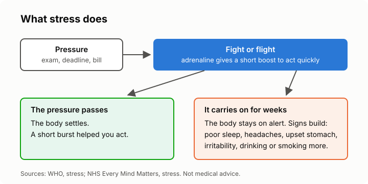

# Lesson 1: What stress is and what it does to you
<!-- facts: Crisis and help lines; Signs of stress -->

## By the end, the learner can

- Say in their own words what stress is, and why a little of it is useful.
- Explain the "fight or flight" response, and why short bursts of stress can help.
- Name signs of stress in the body, the mind and behaviour.
- Explain why stress that goes on for a long time is the kind to deal with.

## Key ideas

**Stress is a normal reaction to pressure.** An exam, a deadline, an argument, a bill you can't
pay: your body treats them as a challenge to deal with. WHO's definition is in `facts.md`.

**Fight or flight.** Under pressure your body releases adrenaline, which gives you a short boost
to act quickly. That is useful for a short time, like before a race or an interview, and it
fades once the moment has passed.

**The problem is when it doesn't switch off.** Pressure that carries on for weeks keeps the body
on alert. That is when the signs in `facts.md` show up: poor sleep, headaches, an upset stomach,
snapping at people, trouble concentrating, eating, drinking or smoking more.

**Signs come in three kinds:** in the body (headaches, tense muscles), in the mind (worry, racing
thoughts) and in what you do (avoiding people, drinking more). People notice different ones first.

**It isn't weakness.** Everyone has a stress response. What helps is noticing your own early
signs, so you can act before they pile up.

## Worked example

Sipho has three exams in one week. The night before the first, his heart races and he can't
settle, but in the exam he feels sharp. That's the stress response doing its job. A month later
the exams are over but he still sleeps badly and has headaches, because family money worries have
taken their place. That longer-lasting stress is the kind the rest of this course is about.

## Exercise

Ask the learner to sort these into body, mind or behaviour: a tight jaw, going over the same worry
again and again, cancelling plans with friends, an upset stomach, forgetting things. Then ask
which signs they tend to notice first in themselves (they can keep the answer private).

## Sources

- [WHO: stress](https://www.who.int/news-room/questions-and-answers/item/stress)
- [NHS Every Mind Matters: stress](https://www.nhs.uk/every-mind-matters/mental-health-issues/stress/)
