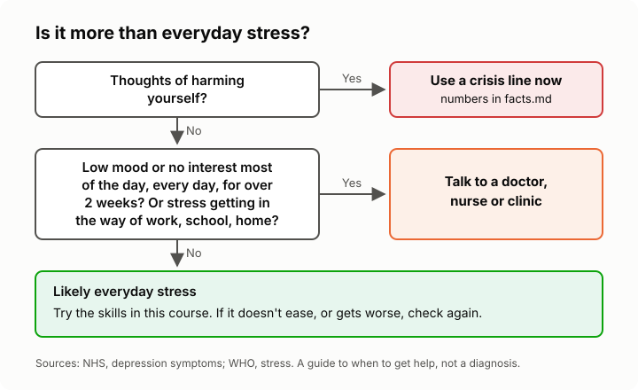

# Lesson 2: Stress, burnout, anxiety or depression?
<!-- facts: Crisis and help lines; When it may be more than stress -->

## By the end, the learner can

- Explain the difference between everyday stress and burnout.
- Say how anxiety and depression differ from ordinary stress, using the guidance in `facts.md`.
- Say when the official guidance suggests talking to a doctor, nurse or clinic.
- Explain why a course or an AI can't tell them which one they have.

## Key ideas

**Stress usually has a cause and eases when the cause goes.** It can be unpleasant, but it moves
with your situation.

**Burnout is about work.** WHO describes it as work stress that has gone on too long without being
managed: feeling drained, switching off from or feeling cynical about the job, and doing it less
well. It is not a medical diagnosis, and it applies only to work (`facts.md`).

**Anxiety sticks around.** NIMH describes anxiety as a feeling of dread that stays even when
there's no clear threat, and gets in the way of life. When worry about many things is hard to
control for months, a doctor may look at generalised anxiety disorder (`facts.md`).

**Depression is more than a bad week.** Low mood or losing interest in things, most of the day,
nearly every day, for more than two weeks, is a reason to see a health worker (`facts.md`).

**These overlap and only a professional can tell them apart.** Long stress can lead to anxiety or
depression. The tutor will never tell you which you have, but it can tell you when the guidance
says to get checked. Getting checked early is sensible, not dramatic.

**Thoughts of harming yourself always mean getting help now,** using the crisis lines in
`facts.md`.

## Worked example

Lerato has felt flat for a month. She has stopped enjoying netball, sleeps badly and can't see the
point of much. Her stress started with a hard job, but now it's there on good days too. The NHS
guidance on low mood lasting over two weeks fits her, so the sensible step is a clinic or doctor
visit, not just better time management.

## Exercise

Give the learner three short made-up stories (a deadline week, a nurse who dreads every shift and
feels numb at work, someone who has felt low every day for six weeks). Ask what the guidance in
`facts.md` suggests for each, without giving anyone a diagnosis.

## Sources

- [WHO: burn-out an occupational phenomenon](https://www.who.int/news/item/28-05-2019-burn-out-an-occupational-phenomenon-international-classification-of-diseases)
- [NIMH: I'm so stressed out!](https://www.nimh.nih.gov/health/publications/so-stressed-out-fact-sheet)
- [NHS: depression symptoms](https://www.nhs.uk/mental-health/conditions/depression-in-adults/symptoms/)
