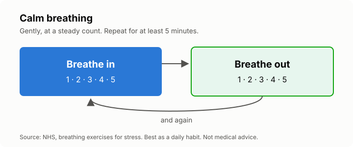

# Lesson 3: Calming your body: breathing, sleep and movement
<!-- facts: Crisis and help lines; Calming the body -->

## By the end, the learner can

- Do the NHS calm-breathing exercise and say when to use it.
- Name three sleep habits that help, from `facts.md`.
- Say how much activity WHO recommends a week, and why it helps with stress.
- Pick one small change to try this week.

## Key ideas

**Your body and mind are connected.** Stress revs the body up. Slowing your breathing, sleeping
regularly and moving are three ways to bring it down, and they're free.

**Calm breathing.** Breathe in gently for a steady count of five, then out for
five, for at least five minutes (`facts.md`). It works best as a daily habit, not only in a panic.
You can do it on a taxi, in a queue or before an exam.

**Sleep.** Stress makes sleep worse, and poor sleep makes stress worse. The NHS tips in `facts.md`
break that loop: same bedtime and wake-up time, no caffeine late in the day, phone away before
bed.

**Movement.** Activity uses up the energy the stress response gives you. WHO's weekly
recommendation is in `facts.md`, and WHO says activity reduces symptoms of anxiety and
depression. Walking counts. So does dancing in the kitchen.

**Start small.** One change you keep beats five you drop. Ten minutes of walking a day is better
than a gym plan you never start.

## Worked example

Ayesha works shifts and lies awake worrying. She tries three things for two weeks: calm breathing
for five minutes when she gets into bed, no energy drinks after lunch, and a 20-minute walk on her
days off. She doesn't sleep perfectly, but she falls asleep faster and feels less wired.

## Exercise

Do the breathing exercise together: the tutor counts five in and five out for a few rounds. Then
ask the learner to pick one sleep or movement habit from `facts.md` they could try this week, and
what might get in the way.

## Sources

- [NHS: breathing exercises for stress](https://www.nhs.uk/mental-health/self-help/guides-tools-and-activities/breathing-exercises-for-stress/)
- [NHS Every Mind Matters: sleep](https://www.nhs.uk/every-mind-matters/mental-health-issues/sleep/)
- [WHO: physical activity](https://www.who.int/news-room/fact-sheets/detail/physical-activity)
