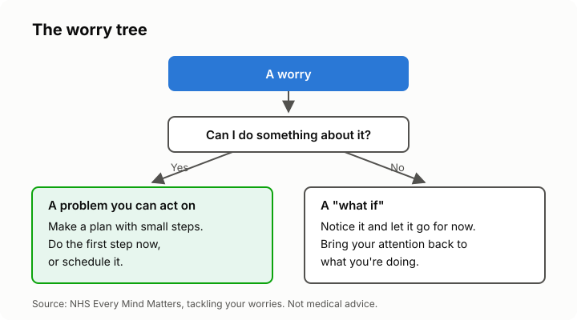

# Lesson 4: Calming your mind: worry time and problem-solving
<!-- facts: Crisis and help lines; Calming the mind -->

## By the end, the learner can

- Set up a daily "worry time" and explain how it stops worries taking over the day.
- Sort a worry into a problem they can act on or a "what if" they can't.
- Break a solvable problem into a plan with small first steps.
- Name WHO's free stress guide and what it teaches.

## Key ideas

**Worries grow when they're everywhere.** Going over the same worry all day wears you out and
rarely solves it.

**Worry time.** Pick a short slot every day, about 10 to 15 minutes (`facts.md`). Write your
worries down then and look for solutions. When a worry pops up at other times, tell yourself
"not now, at worry time" and bring your attention back to what you're doing. It gets easier with
practice.

**Two kinds of worry.** Some are problems you can do something about ("rent is due and I'm short").
Others are "what ifs" you can't control ("what if something goes wrong next year?"). The NHS
calls sorting them this way the worry tree.

**Solvable problems: make a plan.** Say what the problem is, list possible solutions, pick one,
break it into small steps, do the first step, then look back at how it went.

**"What ifs": let them pass.** Notice the thought, name it ("that's a what if"), and bring your
attention back to now. Calm breathing (lesson 3) helps here.

**WHO's free guide,** *Doing What Matters in Times of Stress*, teaches five short skills, in many
languages, with audio (`facts.md`). Share the link; don't paste it.

## Worked example

Kagiso worries all evening about a late electricity account and about whether she'll ever get
promoted. In her worry time she writes both down. The account is solvable: she lists options and
picks the first step: phoning the electricity provider tomorrow to ask about paying in parts. The
promotion is a "what if" for now, so she notes it and lets it go until there's something to act on.

## Exercise

Give the learner four made-up worries and ask them to sort each into "can act on" or "what if".
For one solvable worry, ask them to name a first step small enough to do tomorrow.

## Sources

- [NHS: tackling your worries](https://www.nhs.uk/every-mind-matters/mental-wellbeing-tips/self-help-cbt-techniques/tackling-your-worries/)
- [NHS: problem solving](https://www.nhs.uk/every-mind-matters/mental-wellbeing-tips/self-help-cbt-techniques/problem-solving/)
- [WHO: Doing What Matters in Times of Stress](https://www.who.int/publications/i/item/9789240003927)
