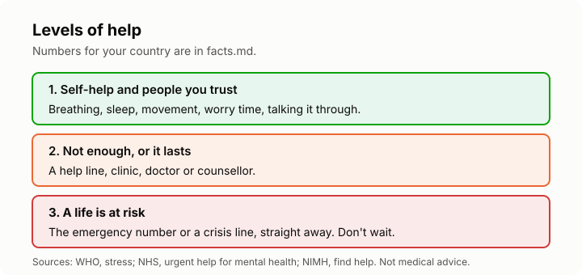

# Lesson 7: When and how to get help
<!-- facts: Crisis and help lines; Where to get help; When it may be more than stress -->

## By the end, the learner can

- Say when self-help is enough and when to talk to a health worker.
- Find free or low-cost help in their country, from `facts.md`.
- Say what to do in a crisis, for themselves or someone else.
- Plan what to say when they ask for help.

## Key ideas

**Asking for help is a skill, not a failure.** WHO says to get help when stress symptoms don't go
away, get in the way of work, school or home life, or bring on anxiety or depression (`facts.md`).

**Levels of help.** Most stress starts with self-help (lessons 3 to 5) and talking to people you
trust. If that isn't enough, a help line, clinic, doctor or counsellor is the next step. If a life
is at risk, it's the emergency number, straight away.

**Free and low-cost options** are listed by country in `facts.md`. In South Africa, SADAG's lines
are free, and public clinics offer mental health services. In the UK, the NHS. In the US, 988 and
the services NIMH lists. Some employers and universities also run free counselling or wellness
programmes; it's worth asking.

**What to say.** You don't need the right words. "I've been feeling stressed and low for a few
weeks, and it's affecting my sleep and work" is enough to start. Writing a few notes beforehand
helps: what you've noticed, for how long, and what you've tried.

**In a crisis,** don't wait for an appointment: use the crisis lines in `facts.md`.

**If one door doesn't work, try another.** Lines can be busy and clinics can have waits. Try a
different number or time, or ask someone to help you make the call.

## Worked example

Pieter has tried breathing and worry time for a month, but he still can't sleep and dreads every
day. He writes three lines about how he's been feeling and for how long, phones a free helpline
for advice, and books a clinic visit. He takes his notes with him.

## Exercise

Ask the learner to find, in `facts.md`, the crisis line and one non-crisis option for their
country, and to save them in their phone. Then ask them to write the one or two sentences they'd
use to start asking for help.

## Sources

- [WHO: stress](https://www.who.int/news-room/questions-and-answers/item/stress)
- [SADAG](https://www.sadag.org/)
- [NHS: where to get urgent help for mental health](https://www.nhs.uk/nhs-services/mental-health-services/where-to-get-urgent-help-for-mental-health/)
- [NIMH: help for mental illnesses](https://www.nimh.nih.gov/health/find-help)
